# ORIGINAL UNIVERSE - 우주 환경·재해 대응 시뮬레이터

[](https://github.com/ryushin01/Original_Universe/actions/workflows/ci.yml)


태양계에서 우주 거대 구조까지 오가며 소행성 충돌, 태양 폭풍, 초신성·감마선 폭발, 블랙홀 근접 통과, 유성우, 태양의 노화, 신화 속 우주적 존재의 격돌을 일으키고 다이슨 스웜·링월드·궤도 이동 같은 우주 구조물로 대응해 보는 3D 우주 시뮬레이터입니다. [TerraNova](https://github.com/ryushin01/TerraNova)의 우주판입니다.

**[데모 바로 보기](https://ryushin01.github.io/Original_Universe/)** · [Storybook](https://ryushin01.github.io/Original_Universe/storybook/)

> **프로젝트 상태:** 1.0.0으로 정식 공개한 **개인 프로젝트**입니다. 행성 위치는 NASA JPL 궤도 요소로 계산하지만, 태양 진화·기후·피해 규모·우주 구조물은 단순화한 모델이라 교육·탐색용으로만 쓰세요. 디자인은 [Space Advisor](https://www.cssdesignawards.com/sites/space-advisor/28977/)(Akufen)를, 소개 화면은 [Árstraumur](https://arstraumur.music/)의 불러오기 화면과 스크롤 우주 여정 구성을 참고했습니다(글·로고·그림·코드는 이 프로젝트에서 직접 만듦).

## 화면

| 소개 화면                                                                                                                                                                                                | 태양계와 목적지 정보                                                                                      |
| -------------------------------------------------------------------------------------------------------------------------------------------------------------------------------------------------------- | --------------------------------------------------------------------------------------------------------- |
| 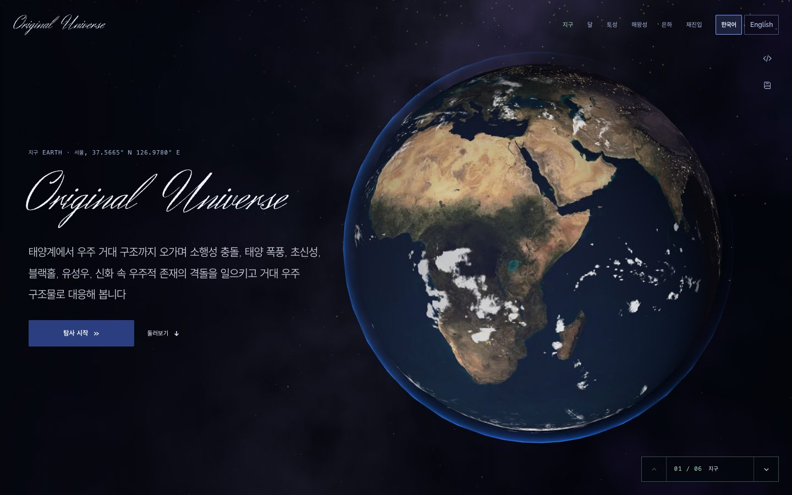 | 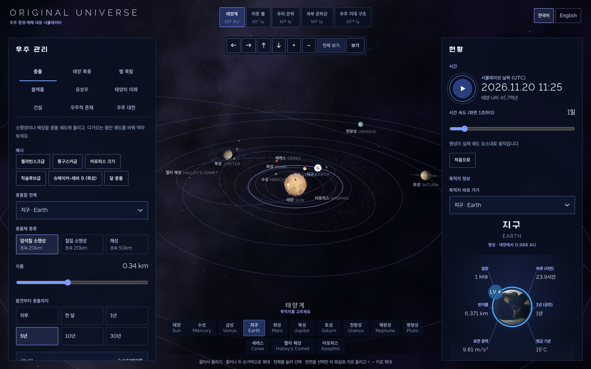 |

| 토성과 측지선 선택 표시                                                      | 캐링턴급 태양 폭풍                                                                                             |
| ---------------------------------------------------------------------------- | -------------------------------------------------------------------------------------------------------------- |
| 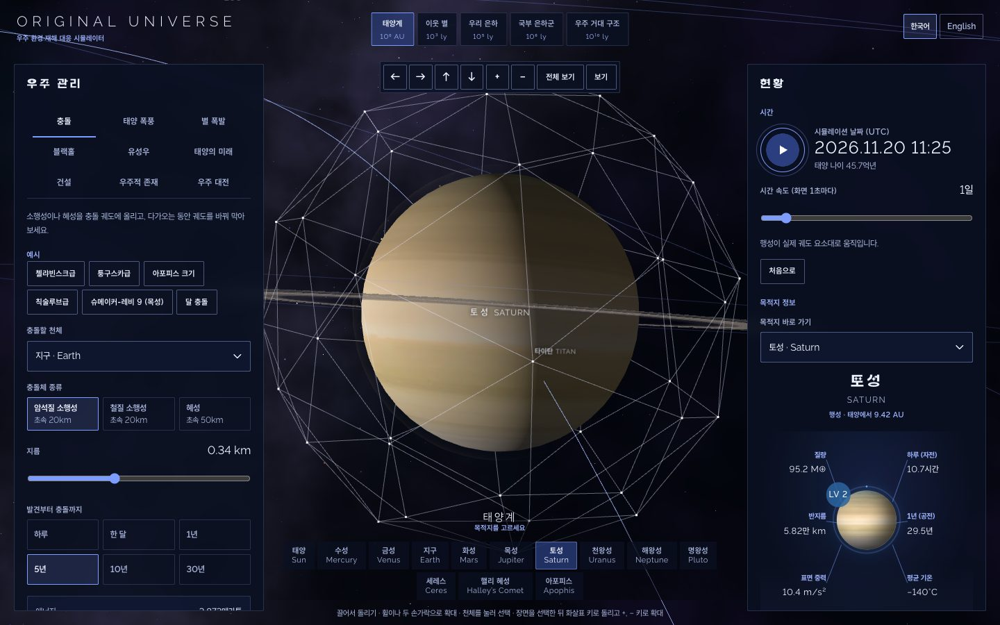 | 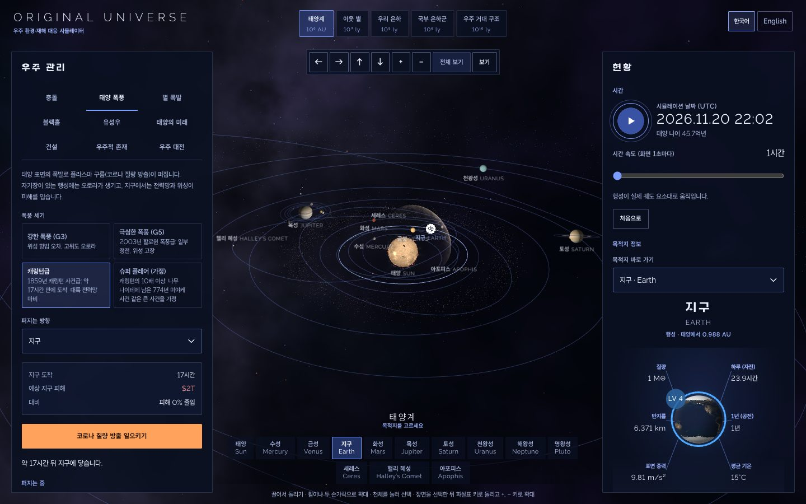 |

| 태양 근접 (홍염·활동 영역)                                                                                 | 핼리 혜성 핵 (땅콩 모양)                                                                                   |
| ---------------------------------------------------------------------------------------------------------- | ---------------------------------------------------------------------------------------------------------- |
| 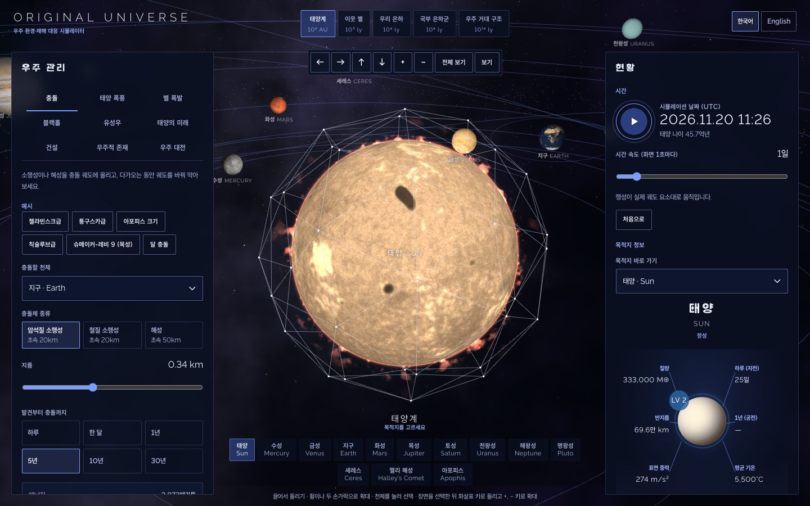 | 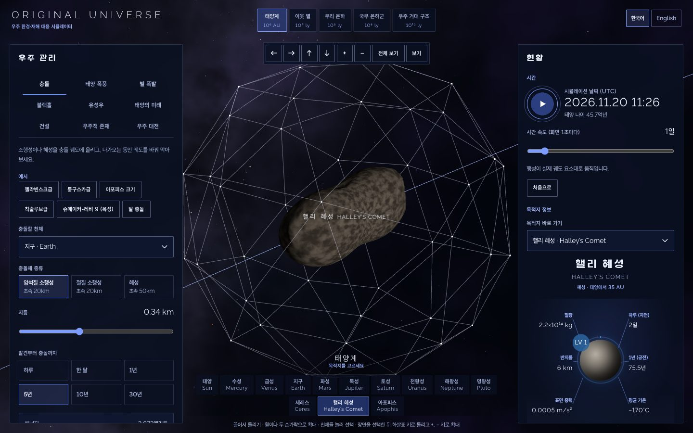 |

| 블랙홀 근접 통과                                                                                                     | 우주적 존재의 격돌                                                                                                                                                                                                                 |
| -------------------------------------------------------------------------------------------------------------------- | ---------------------------------------------------------------------------------------------------------------------------------------------------------------------------------------------------------------------------------- |
| 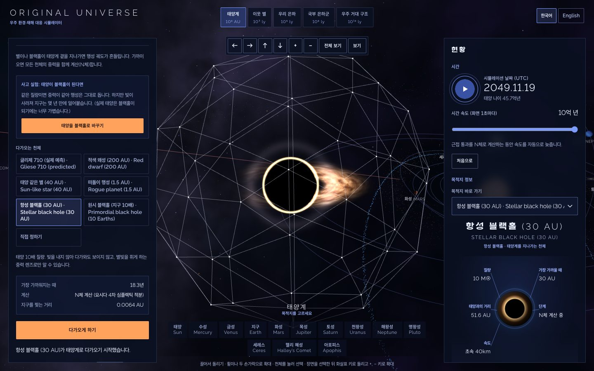 | 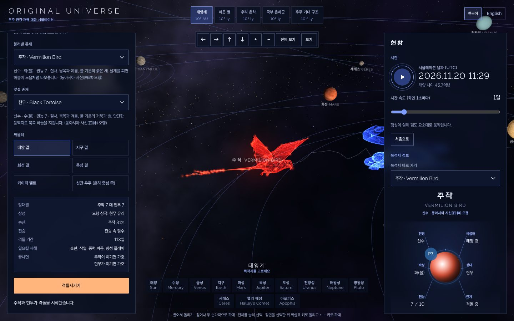 |

| 아펩의 강림과 태양 잠식                                                                                                                                   | 우리 은하                                                                           |
| --------------------------------------------------------------------------------------------------------------------------------------------------------- | ----------------------------------------------------------------------------------- |
| 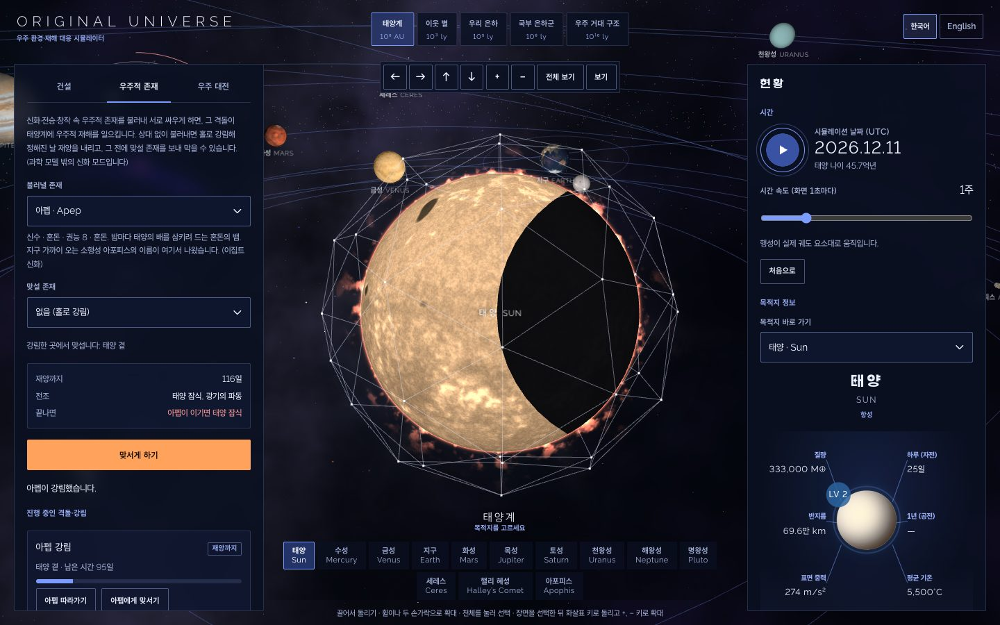 | 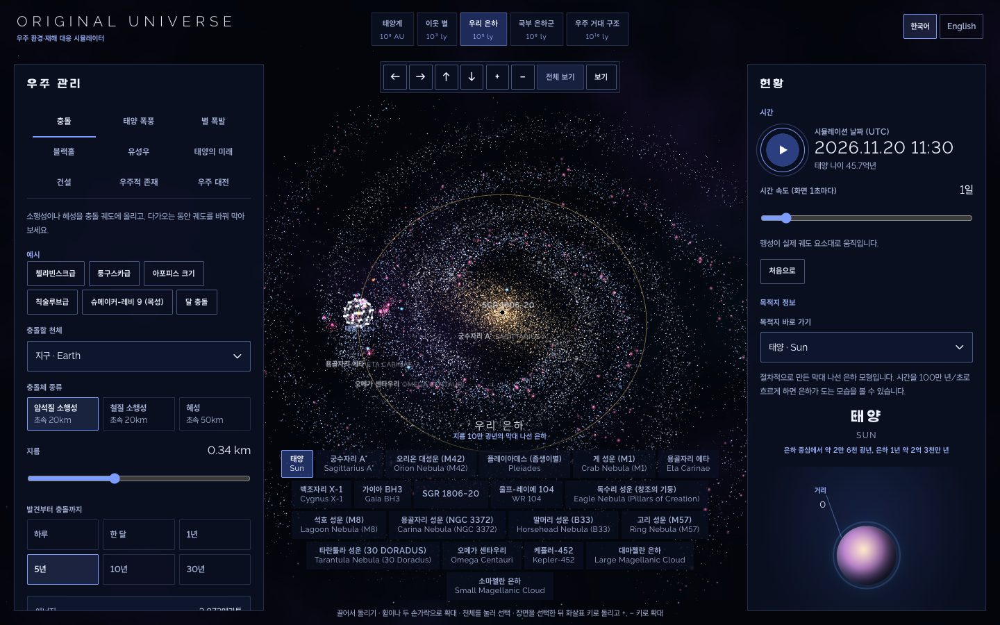 |

| 우주 대전                                                                                                                                                                    | 은하 사이를 질러가는 레이저                                                                                         |
| ---------------------------------------------------------------------------------------------------------------------------------------------------------------------------- | ------------------------------------------------------------------------------------------------------------------- |
| 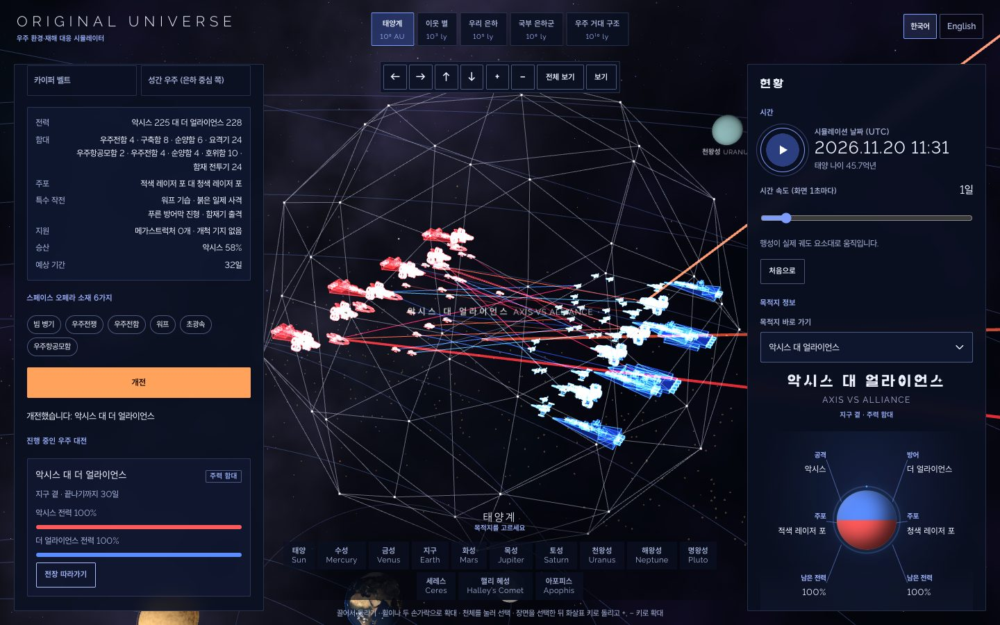 | 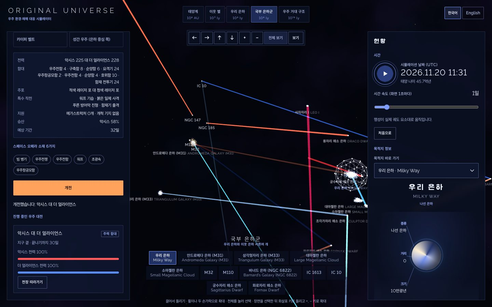 |

| 우주 거대 구조                                                                          | 모바일                                                                                                                                      |
| --------------------------------------------------------------------------------------- | ------------------------------------------------------------------------------------------------------------------------------------------- |
| 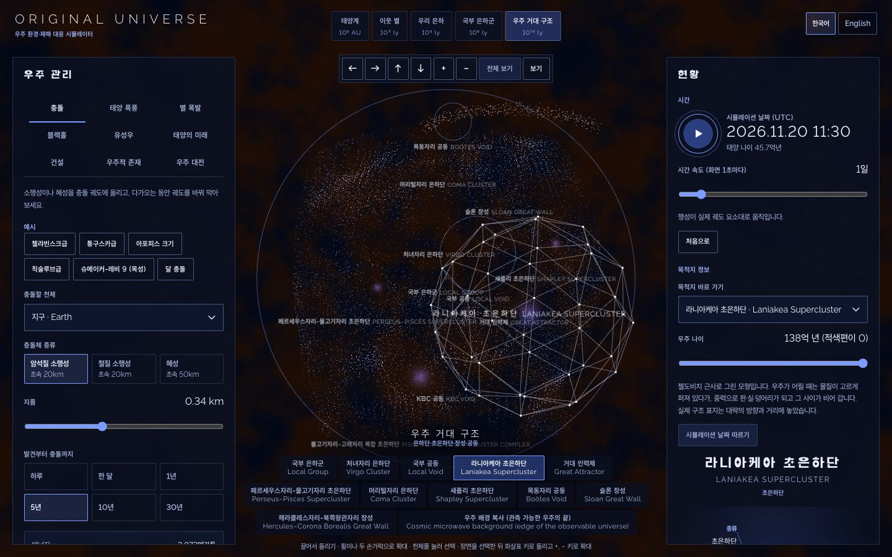 | 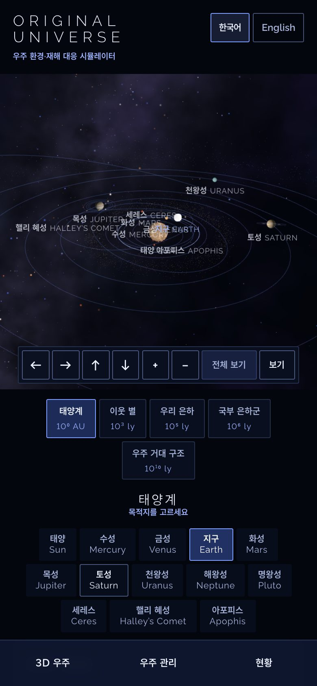 |

## 주요 기능

| 구분             | 내용                                                                                                                                                                                                                                                                                                                                                                                                                                                                                                                                                                                                                                   |
| ---------------- | -------------------------------------------------------------------------------------------------------------------------------------------------------------------------------------------------------------------------------------------------------------------------------------------------------------------------------------------------------------------------------------------------------------------------------------------------------------------------------------------------------------------------------------------------------------------------------------------------------------------------------------- |
| 소개 화면        | 필기체 로고가 써지는 불러오기 화면(실제 3D 불러오기 진행률과 준비 단계 문구, 건너뛰기), 스크롤하면 지구 → 달 → 토성 → 해왕성 → 우리 은하 → 다시 지구로 카메라가 옮겨 가는 둘러보기(천체 좌표 표지, 구간 메뉴, 이전·다음 구간), 움직임 줄이기 대응                                                                                                                                                                                                                                                                                                                                                                                      |
| 이름 표기        | 천체와 우주적 존재 이름을 한국어·영어로 함께 (3D 이름표, 목적지, 정보 카드, 고르는 목록)                                                                                                                                                                                                                                                                                                                                                                                                                                                                                                                                               |
| 5단계 규모       | 태양계 → 이웃 별(1,000광년) → 우리 은하 → 국부 은하군 → 우주 거대 구조. 규모마다 3D 장면과 목적지 목록, 정보 카드                                                                                                                                                                                                                                                                                                                                                                                                                                                                                                                      |
| 태양계           | JPL 궤도 요소로 계산한 행성·위성·왜소 행성·혜성, IAU 자전축, 소행성대·카이퍼 벨트, 거주 가능 영역, 압축·실제 거리 보기, 고른 천체를 감싸는 측지선                                                                                                                                                                                                                                                                                                                                                                                                                                                                                      |
| 시간             | 1시간/초부터 10억 년/초까지, 태양 나이에 따른 광도·반지름·질량 변화(적색 거성이 수성·금성·지구를 삼킴, 행성상 성운, 백색 왜성)                                                                                                                                                                                                                                                                                                                                                                                                                                                                                                         |
| 충돌·편향        | 지름 10m~100km 소행성·혜성의 에너지·크레이터·피해 단계, 운동 충돌체·중력 견인선·핵폭발 편향과 남은 시간에 따른 빗나감 거리                                                                                                                                                                                                                                                                                                                                                                                                                                                                                                             |
| 태양 폭풍        | 강한 폭풍~슈퍼 플레어 코로나 질량 방출의 원뿔 확산, 도착 시간, 오로라, 전력망 피해와 경보 위성·전력망 보호                                                                                                                                                                                                                                                                                                                                                                                                                                                                                                                             |
| 별 폭발          | 베텔게우스·안타레스·스피카·페가수스자리 IK 초신성, 감마선 폭발, 킬로노바, 마그네타 거대 플레어와 오존층 감소·잔해 도착                                                                                                                                                                                                                                                                                                                                                                                                                                                                                                                 |
| 블랙홀·떠돌이 별 | 글리제 710·적색 왜성·태양형 별·떠돌이 행성·항성/원시 블랙홀의 근접 통과를 N체(요시다 4차) 계산, 궤도 변화·방출·조석 파괴, 태양을 블랙홀로 바꾸는 사고 실험                                                                                                                                                                                                                                                                                                                                                                                                                                                                             |
| 우주적 존재      | 아우터 갓·옛 지배자·코스믹 호러·엘더 갓·신들·천사·악마·신수 40종·영수 12종(구미호·비휴·맥·정위·필방·옥토끼·섬여·천마·누에·라이주·유니콘·그리핀)·몬스터·거대 로봇 94종의 격돌과 강림. 오행 상극·빛의 봉인·전승의 맞수로 정해지는 승산, 우주적 재해 15종(항성 플레어·파편 비·태양 잠식·광기의 파동·중력 파동·삼킴·가호 등), 빛나는 면과 선으로 그린 3D 몸(무료 3D 모델 32종과 계산으로 만든 몸)과 공격·쓰러짐 동작                                                                                                                                                                                                                       |
| 우주 대전        | 스페이스 오페라 모드: 악시스(붉은 레이저)·더 얼라이언스(푸른 레이저)·지구 연방·자유 식민지·은하 제국·벌레떼 군체·우주해적·승천자(사이보그·포스트휴먼)·잊힌 선조·평행우주 균열군·마도 기사단·시간 순찰대 12세력의 함대 전쟁. 란체스터 제곱 법칙 교전과 워프 기습·함재기·강화복 강습·보행 기갑·군체 재생·나노 수복·초능력·마도 결계·봉인 해제(우주적 존재 강림)·시간 되감기·차원 증원·고대 병기·약탈·행성 파괴포·메가스트럭처 지원 사격, 잔해 낙하. 3D 함대(받은 모델과 계산으로 지은 전함·모함·드레드노트·궤도 요새), 여러 색 레이저, 은하 사이를 가로지르는 장거리 레이저. 나무위키 「스페이스 오페라」의 주요 소재 36가지를 모두 담음 |
| 유성우           | 실제 9개 유성우의 극대 날짜와 모혜성 먼지 띠, 지구 대기에 그어지는 유성, 유성 폭풍                                                                                                                                                                                                                                                                                                                                                                                                                                                                                                                                                     |
| 우주 구조물 16종 | 행성 방위 요격망, 우주 기상 경보 위성, 화성 자기장 방패·테라포밍, 오닐 실린더, L1 차양, 지구 궤도 이동, 다이슨 스웜·다이슨 구, 링월드, 항성 엔진 등                                                                                                                                                                                                                                                                                                                                                                                                                                                                                    |
| 문명             | 지구·우주 인구, 쓰는 에너지와 카르다쇼프 척도, 에너지에 따라 늘어나는 예산                                                                                                                                                                                                                                                                                                                                                                                                                                                                                                                                                             |
| 은하·우주        | 절차적 막대 나선 은하와 은하 1년, 안드로메다와의 충돌(제한된 N체), 우주 나이에 따라 자라는 우주 거미줄, 실제 거대 구조 17곳                                                                                                                                                                                                                                                                                                                                                                                                                                                                                                            |
| 미션             | 충돌 회피 작전(2026 PDC), 태양 극대기 버티기, 붉은 행성의 봄, 지구를 옮겨라, 아펩을 막아라 — 결과 대화상자                                                                                                                                                                                                                                                                                                                                                                                                                                                                                                                             |
| 저장·공유·언어   | 주소 공유 링크(공유 미리보기 그림)와 브라우저 저장, 한국어·영어 전환, 홈 화면 설치와 오프라인 캐시                                                                                                                                                                                                                                                                                                                                                                                                                                                                                                                                     |

## 기술 스택


| 구분       | 사용 기술                                                                                                                         |
| ---------- | --------------------------------------------------------------------------------------------------------------------------------- |
| UI         | SolidJS 1.9 (Signals), 빌드 때 첫 화면을 HTML로 그리는 SSR 사전 렌더링, TypeScript 6                                              |
| 3D         | three.js 0.187 (직접 제어)를 Web Worker(OffscreenCanvas)에서 렌더링, 직접 작성한 GLSL 셰이더                                      |
| 시뮬레이션 | 케플러 궤도·N체 적분(요시다 4차 심플렉틱)·ΛCDM 성장 인자·젤도비치 근사를 직접 구현                                                |
| 스타일     | CSS Modules + Lightning CSS(중첩, 컨테이너 쿼리), 웹 폰트(Raleway, 프리젠테이션, 학교안심 별빛하늘)                               |
| 품질       | ESLint(typescript-eslint, eslint-plugin-solid), Prettier, Steiger(FSD), Vitest + Testing Library, Playwright + axe, Lighthouse CI |
| 문서       | Storybook 10 (`storybook-solidjs-vite`, a11y 애드온)                                                                              |
| 배포·CI    | GitHub Pages, GitHub Actions, Service Worker(PWA)                                                                                 |

## 시작하기

Node.js 26(`.nvmrc`)과 pnpm 12가 필요합니다.

```bash
nvm use
pnpm install
pnpm dev    # http://localhost:3100
```

| 명령                                   | 설명                                                                         |
| -------------------------------------- | ---------------------------------------------------------------------------- |
| `pnpm build` / `pnpm preview`          | 정적 사이트 빌드와 첫 화면 사전 렌더링(`dist/client`) / 빌드 결과 실행       |
| `pnpm build:all`                       | 사이트와 Storybook을 함께 빌드 (하위 경로는 `BASE_PATH=/Original_Universe/`) |
| `pnpm lint` / `lint:fsd` / `typecheck` | ESLint / FSD 구조 검사 / 타입 검사                                           |
| `pnpm test`                            | 천체 역학·재해·엔진 단위 테스트와 컴포넌트 테스트                            |
| `pnpm test:e2e`                        | 프로덕션 빌드 E2E·접근성 검사 (먼저 `build` 필요)                            |
| `pnpm lighthouse`                      | Lighthouse CI 점수 검사 (먼저 `build` 필요)                                  |
| `pnpm storybook`                       | Storybook 개발 서버 (`http://localhost:6106`)                                |
| `pnpm fonts`                           | 한글 웹 폰트 다시 만들기 (화면 글자를 바꾼 뒤)                               |
| `pnpm logotype`                        | 소개 화면의 필기체 로고 윤곽 다시 만들기                                     |
| `pnpm models`                          | 우주적 존재 3D 모델 받아 가공하기 (`scripts/models/sources.json`)            |
| `pnpm textures`                        | 위성·왜행성·태양 텍스처 받아 가공하기 (libwebp의 `cwebp`·`dwebp` 필요)       |
| `pnpm screenshots`                     | README 화면 다시 찍기 (`build` 뒤 `preview`를 띄운 다음 `BASE_URL` 지정)     |

## 프로젝트 구조

```
e2e/                     E2E 테스트 (화면 폭, axe, 키보드, 재해·건설·미션·공유 흐름)
public/textures/         행성 텍스처(WebP)
scripts/                 첫 화면 사전 렌더링, PWA 아이콘 생성, 한글 웹 폰트 만들기
src/
├─ app/                  진입점(hydrate·SSR), 전역 스타일과 디자인 토큰
├─ pages/universe/       시뮬레이터 페이지 (FSD pages-first)
│  ├─ model/             천체 역학·태양 진화·기후, 재해·N체, 구조물, 엔진·스토어, 별·은하·우주 자료
│  ├─ lib/               GLSL 셰이더, 은하·우주 거미줄 생성기
│  └─ ui/                소개, 3D 장면(규모별), 패널, 현황·정보 카드
└─ shared/               공통 UI(버튼, 탭, 슬라이더 등), 수학·시간·서식, 다국어
```

## 문서

| 문서                                | 내용                                          |
| ----------------------------------- | --------------------------------------------- |
| [개발 가이드](docs/development.md)  | 구조, 시뮬레이션 모델, 렌더링, 테스트, 접근성 |
| [데이터 출처](docs/data-sources.md) | 궤도 요소·텍스처·천체 자료와 라이선스         |
| [성능](docs/performance.md)         | Lighthouse 측정 결과, 묶음 크기, 메모리       |
| [배포](docs/deployment.md)          | GitHub Pages 배포와 하위 경로 설정            |
| [버전 기록](CHANGELOG.md)           | 버전별 변경 내용                              |

## 웹 폰트

| 글꼴                 | 쓰는 곳                                                                      | 굵기                | 저작자                                               | 라이선스    | 원본                                                                                                                  |
| -------------------- | ---------------------------------------------------------------------------- | ------------------- | ---------------------------------------------------- | ----------- | --------------------------------------------------------------------------------------------------------------------- |
| Raleway              | 영문·숫자 (제목·본문)                                                        | 100~900 가변        | Matt McInerney, Pablo Impallari, Rodrigo Fuenzalida  | SIL OFL 1.1 | [Google Fonts](https://fonts.google.com/specimen/Raleway) · [impallari/Raleway](https://github.com/impallari/Raleway) |
| 프리젠테이션         | 한글 (본문·작은 제목)                                                        | 200·300·400·600·700 | 이주임, 피티앤                                       | SIL OFL 1.1 | [배포처](https://freesentation.blog) · [눈누](https://noonnu.cc/font_page/1369)                                       |
| 학교안심 별빛하늘    | 한글 큰 제목 (패널 제목, 천체 이름, 결과 창 제목)                            | Bold                | 한국교육학술정보원(KERIS), 디자인 헤움디자인(허원준) | SIL OFL 1.1 | [학교 안심폰트](https://copyright.keris.or.kr/wft/fntDwnld)                                                           |
| Herr Von Muellerhoff | 소개 화면의 필기체 로고 (글자 윤곽만 그림으로 씀, 글꼴 파일은 배포하지 않음) | Regular             | Alejandro Paul (Sudtipos)                            | SIL OFL 1.1 | [Google Fonts](https://fonts.google.com/specimen/Herr+Von+Muellerhoff)                                                |

모든 글꼴을 저장소에 넣어 같은 사이트에서 제공합니다(외부 글꼴 CDN 없음). 프리젠테이션은 화면에 쓰는 글자만 담은 작은 파일을 먼저 받고, 나머지 글자는 글자 묶음별 조각으로 나눠 그 글자를 쓸 때만 받습니다. 학교안심 별빛하늘은 한글 큰 제목에 쓰는 한글(패널 제목·천체 이름 등 237자)만 담은 파일 하나(약 15KB)를 씁니다([개발 가이드](docs/development.md#글꼴)). 라이선스 전문은 `scripts/fonts/freesentation/OFL.txt`, `scripts/fonts/byeolbichhaneul/OFL.txt`에 있습니다.

## 출처

| 자료                                                                                                                                                                                | 저작자                                                                                           | 사용 허락                                                     | 원본                                                                                                        |
| ----------------------------------------------------------------------------------------------------------------------------------------------------------------------------------- | ------------------------------------------------------------------------------------------------ | ------------------------------------------------------------- | ----------------------------------------------------------------------------------------------------------- |
| 행성·태양·세레스 텍스처 (수성·금성·달·화성·목성·토성과 고리·천왕성·해왕성·태양·세레스, 세레스는 일부 가상 지형)                                                                     | Solar System Scope                                                                               | [CC BY 4.0](https://creativecommons.org/licenses/by/4.0/)     | [Solar System Scope Textures](https://www.solarsystemscope.com/textures/)                                   |
| 지구 텍스처 (색·밤 불빛·구름)                                                                                                                                                       | three.js authors                                                                                 | MIT                                                           | [three.js 예제 텍스처 (r160)](https://github.com/mrdoob/three.js/tree/r160/examples/textures/planets)       |
| 위성·명왕성 텍스처 (이오·유로파·가니메데·칼리스토·타이탄·명왕성, 빛깔을 맞추고 빈 곳을 채움)                                                                                        | NASA                                                                                             | NASA 미디어 이용 지침 (출처 표기)                             | [NASA 3D Resources](https://github.com/nasa/NASA-3D-Resources)                                              |
| 행성 근사 궤도 요소                                                                                                                                                                 | E. M. Standish, NASA JPL                                                                         | 공개 과학 자료                                                | [Approximate Positions of the Planets](https://ssd.jpl.nasa.gov/planets/approx_pos.html)                    |
| 소천체 궤도 요소 (세레스·아포피스·핼리 혜성·유성우 모천체)                                                                                                                          | NASA JPL Solar System Dynamics                                                                   | 공개 과학 자료                                                | [Small-Body Database API](https://ssd-api.jpl.nasa.gov/doc/sbdb.html)                                       |
| three.js (3D)                                                                                                                                                                       | three.js authors                                                                                 | MIT                                                           | [three.js](https://github.com/mrdoob/three.js)                                                              |
| SolidJS (화면)                                                                                                                                                                      | Ryan Carniato                                                                                    | MIT                                                           | [solid](https://github.com/solidjs/solid)                                                                   |
| 아우터 갓·옛 지배자·우주에서 온 색채 (이름과 원작 설정)                                                                                                                             | H. P. Lovecraft                                                                                  | 퍼블릭 도메인                                                 | 러브크래프트 원작 단편 (설명은 이 프로젝트에서 직접 씀)                                                     |
| 노란 옷의 왕                                                                                                                                                                        | Robert W. Chambers                                                                               | 퍼블릭 도메인                                                 | 『The King in Yellow』(1895)                                                                                |
| 신수 후보 (이름과 전승 참고)                                                                                                                                                        | 나무위키 기여자                                                                                  | CC BY-NC-SA 2.0 KR (문장은 옮기지 않음)                       | [상상의 동물/목록](https://namu.wiki/w/%EC%83%81%EC%83%81%EC%9D%98%20%EB%8F%99%EB%AC%BC/%EB%AA%A9%EB%A1%9D) |
| 우주적 존재·우주 대전 3D 모델 26종 (새·짐승·거미·지네·그림자 인간, 문어·오징어·해파리·거북, 거대 로봇, 비행접시·정찰선·화물선·우주선). 색·텍스처를 빼고 면을 줄여 홀로그램으로 그림 | Google Data Arts Team, Poly by Google, Dann Beeson, Aaron Clifford, Yogoshimo 2.0, Jason Neufeld | [CC BY 3.0](https://creativecommons.org/licenses/by/3.0/)     | [Poly Pizza](https://poly.pizza), 모델별 원본은 [데이터 출처](docs/data-sources.md#3d-모델-publicmodels)    |
| 우주적 존재·우주 대전 3D 모델 19종 (용·사람·왕·마법사·기계·고래·아귀·말벌, 전투기·호위함·구축함·무인기·쾌속선)                                                                      | AliceCassie, Quaternius, Kenney                                                                  | [CC0 1.0](https://creativecommons.org/publicdomain/zero/1.0/) | [Poly Pizza](https://poly.pizza)                                                                            |

자전축·천체 목록·모델 근거, 우주적 존재 94종의 출전 같은 자세한 자료 출처는 [데이터 출처](docs/data-sources.md)에 있습니다. 아이콘, 셰이더로 그린 태양·블랙홀·은하·우주 거미줄, 우주적 존재의 별자리 모습과 계산으로 만든 3D 몸(뱀·용·공허·눈·바퀴 등)과 설명, 화면 사진은 이 프로젝트에서 직접 만들었습니다. 엘더 갓 진영과 거대 로봇은 이 프로젝트의 창작이며, 오거스트 덜레스 이후의 설정 문장이나 특정 게임의 이름·모습·설정은 쓰지 않았습니다.
